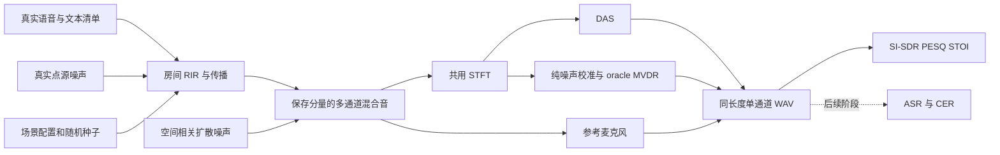

# 多通道远场语音前端 + 下游 ASR 评测

按《项目二执行手册》分阶段实现。第一、二阶段基础设施已完成：Ubuntu Conda 环境、
阵列与频域 DAS 原语、音频/STFT、种子化场景、房间/扩散噪声仿真与数据清单检查。
第三阶段已接入真实测试语料、200 条正式仿真数据以及 DAS/oracle MVDR 批量评测。
尚未完成 DOA、神经掩码训练、ASR 与最终消融/发布。
任何图示或理论噪声增益都不等于真实语音实验结果。

最终工作目录：Ubuntu `/home/kingcrab/farfield-asr`。
Windows `F:\sharefile\farfield-asr` 是初始传递副本；后续以 Ubuntu 本地项目为准。

## 首次安装（Ubuntu）

已存在 Miniconda 和 VMware 共享目录时，从 Ubuntu 终端运行：

```bash
bash /mnt/hgfs/sharefile/farfield-asr/scripts/install_in_home.sh
```

脚本拒绝覆盖已有本地项目，创建独立环境 `farfield-asr`，安装本地包，
运行测试、生成方向图，并记录依赖版本。网络或求解失败时保留日志。
若复制成功后安装中断，可以直接重试：

```bash
cd /home/kingcrab/farfield-asr
bash scripts/bootstrap.sh
```

基础环境可用后重复第一阶段实验：

```bash
conda activate farfield-asr
cd /home/kingcrab/farfield-asr
python -m pytest -q
python scripts/plot_beampattern.py
```

## 目录

```text
configs/base.yaml               场景参数草案，单位写在键名中
src/farfield_asr/arrays.py       4 麦线阵、6 麦圆阵、远场导向矢量
src/farfield_asr/beamforming.py  DAS 权重与频域应用
src/farfield_asr/transforms.py   多通道可逆 STFT/ISTFT
src/farfield_asr/audio_io.py     WAV 读写、布局与采样率约束
src/farfield_asr/scenes.py       场景配置、几何约束与固定种子抽样
src/farfield_asr/simulation.py   RIR、扩散场、混合分量与 RT60 拟合
src/farfield_asr/corpus.py       语音清单、说话人隔离与文件检查
src/farfield_asr/frontends.py    统一前端接口与纯噪声协方差校准
src/farfield_asr/metrics.py      SI-SDR/PESQ/STOI 与手写 CER 编辑距离
src/farfield_asr/data_access.py  公开 ZIP 按需读取与有界分块缓存
scripts/bootstrap.sh            专用环境安装及基础验证
scripts/plot_beampattern.py     无图形界面的方向图实验
scripts/check_environment.py  环境、源码位置及原生房间仿真验收
scripts/run_phase2.py          场景、RIR 和合成诊断信号生成
scripts/verify_phase2.py       从落盘文件验证分量、SNR/SIR 与重复运行
scripts/validate_corpus.py     正式语音清单导入前检查
scripts/run_phase3.sh          真实语料准备、200 场景生成、评测与图表的一条命令入口
tests/                         几何、重建、仿真、数据泄漏、MVDR 与指标测试
docs/conventions.md             全项目统一的数学与指标约定
docs/progress.md                分阶段交付及真实完成状态
results/generated/             本机生成的图、日志和依赖清单，不进入 Git
```

当前计算链路：阵列坐标 → 声源方向 → 导向矢量 → DAS 权重 → 单通道复数谱。
第二阶段链路：配置 → 场景 → RIR/扩散场 → 可分解混合 → WAV → STFT/ISTFT → 落盘验收。
第三阶段链路：真实语音/噪声清单 → 200 场景 → WAV → ref/DAS/oracle MVDR → 统一指标。
下一阶段接入 DOA 估计和分组误差分析。

2026-10-27 Ubuntu 实测：8 项测试通过，Ruff 与依赖检查通过，四路 RIR 仿真成功。
详细版本与验收见 [第一阶段记录](docs/phase1_validation.md)。

第二阶段：46 项测试通过；100 场景、6 组仿真示例，50 个产物在两次独立运行中逐字节一致。
见 [第二阶段记录与复现命令](docs/phase2_validation.md) 和 [数据导入协议](docs/data_protocol.md)。

第三阶段：59 项测试通过，200 条真实语音仿真测试集、600 个有效前端评测输出。
详见 [第三阶段验收](docs/phase3_validation.md)、[结果表](results/ref_mic.md)、
[五组音频对比](docs/demo_phase3.md) 和 [数据来源](docs/data_sources.md)。

```bash
conda activate farfield-asr
cd /home/kingcrab/farfield-asr
bash scripts/run_phase3.sh
```

主参考为参考麦克风处的目标直达声，三种前端共用裁剪区间；下表为 200 条语句均值。

| 前端 | SI-SDR（dB） | PESQ-WB | STOI | CER |
| --- | ---: | ---: | ---: | --- |
| 未处理 | −8.3272 | 1.0638 | 0.4860 | 未运行 |
| DAS | −6.0904 | 1.0790 | 0.5242 | 未运行 |
| oracle MVDR | −2.5008 | 1.1024 | 0.6163 | 未运行 |

oracle MVDR 使用真值方向和已知纯噪声前缀，不是可以无条件部署的盲处理算法；
CER 必须在后续 ASR 推理后填入，不能以增强分数代替。



## 环境与复现范围

Python 3.11，基础科学计算依赖使用兼容范围；pyroomacoustics 固定为 0.10.1。
首次安装成功后保存 `results/generated/conda-linux-64.explicit.txt` 与
`pip-freeze.txt`，它们记录实际版本；当前配置文件不是完整锁文件。
Ubuntu 虚拟机先以 CPU 跑通。是否存在可用于训练的 CUDA 设备尚未确认，
后续网络采用可在 CPU 运行的小模型，训练规模根据实测决定。

官方参考：[Conda 环境创建](https://docs.conda.io/projects/conda/en/stable/commands/env/create.html)、
[pyroomacoustics 项目发布与 Python 要求](https://pypi.org/project/pyroomacoustics/)。

