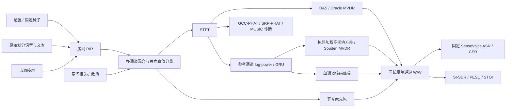
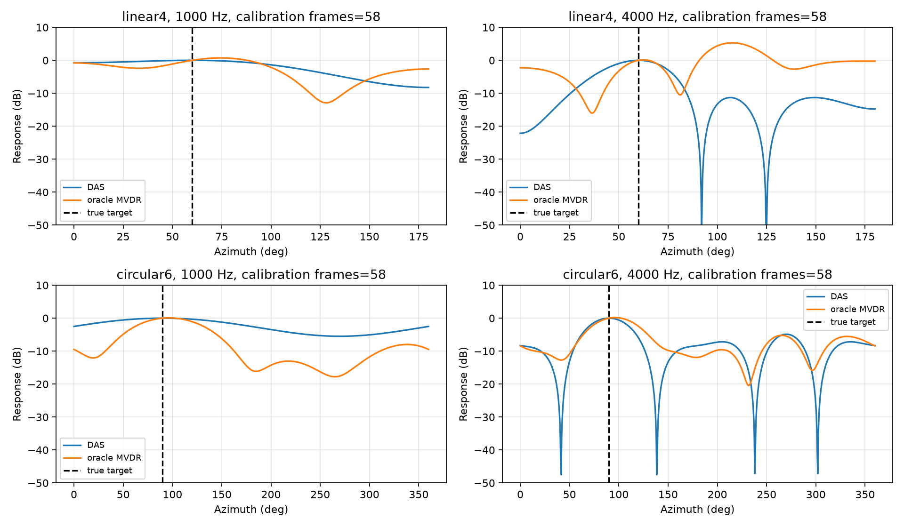
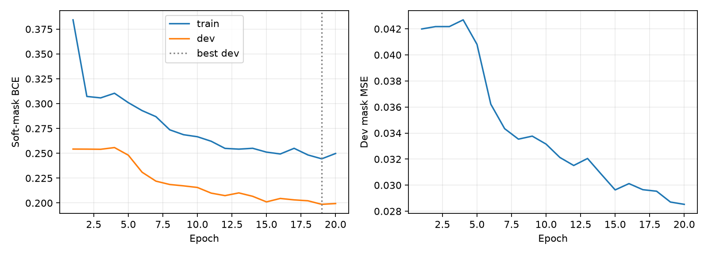

# 多通道远场语音前端 + 下游 ASR 评测

可复现的 CPU 实验项目：房间仿真 → 传统/神经波束形成 → 固定中文 ASR → 增强与识别联合分析。
包含 200 条真实带文本测试语音、六种前端、三种 DOA、轻量 GRU 自训练及配对消融。
实际实验目录为 Ubuntu `/home/kingcrab/farfield-asr`；Windows 共享目录用于传递与查看交付。

## 主要结果

200 条原始 AISHELL 测试语音、20 位说话人；六种前端共用测试输入和文本规范化。
SI-SDR/PESQ/STOI 参考为物理参考麦克风的目标直达声，所有处理音频裁掉相同 0.6 秒校准前缀。

| 前端 | SI-SDR / dB | PESQ-WB | STOI | CER |
| --- | ---: | ---: | ---: | ---: |
| 未处理 | -8.3272 | 1.0638 | 0.4860 | 37.89% |
| DAS | -6.0904 | 1.0790 | 0.5242 | 28.91% |
| Oracle MVDR | -2.5008 | 1.1024 | 0.6163 | 17.27% |
| 理想功率掩码 MVDR | -1.9778 | 1.1771 | 0.6018 | 17.41% |
| 神经掩码 MVDR | -6.1756 | 1.0740 | 0.5123 | 33.37% |
| 单通道补充模型 | -4.8706 | 1.1641 | 0.4997 | 51.85% |

固定 SenseVoiceSmall int8 ONNX CPU，中文、关闭 ITN、batch=1。
干净语音 200 条 CER 为 2.66%，固定 50 条子集为 1.75%。CER 按总编辑数/总字符数汇总。
完整 [ASR 表与协议](results/asr.md)、[十个指标不一致案例](analysis.md)。

神经 MVDR 尚未超过 DAS；单通道模型改善部分增强指标却损害识别，负结果完整保留。
Oracle MVDR 使用真实方向和已知纯噪声校准段；IRM 使用真实分量，均为额外信息诊断，不能直接部署。
单通道模块是本轮在项目一独立子目录补建，复用同一 GRU 权重；不是独立预训练系统。

## 架构



## 一条命令复现

Ubuntu 22.04/24.04、Linux x86-64、已安装 Miniconda，`curl` 可用。
在克隆后的项目根目录运行：

```bash
bash scripts/reproduce.sh
```

默认 Conda 根目录为 `~/miniconda3`，其他位置使用 `CONDA_ROOT=/你的路径 bash scripts/reproduce.sh`。
入口创建 `farfield-asr`（仿真/训练，NumPy 2.x 兼容）与 `farfield-asr-decode`（ASR，NumPy 1.26.4），
安装固定 PyTorch CPU 版本，准备公开数据、训练、评测并生成表格与图。
完整数据/权重/缓存只留在本机；首次运行需要网络、数 GB 磁盘和 CPU 计算时间，网络速度可能主导耗时。
项目一补充模块导出到 `~/speech-front-end/denoising`，拒绝覆盖内容不同的已有文件。

已完成的训练、增强音频、ASR、消融会校验输入/代码/产物哈希后复用。
若协议改变，脚本拒绝混用旧缓存；请保留旧实验，再设置新的输出目录，而非删除证据。
仅核查本机已有成果：

```bash
bash scripts/reproduce.sh --verify-only
```

完整脚本在本机已有数据上验收；未声称在另一台全新机器上重新下载验证全部网络端点。
本次使用 Ubuntu CPU 完成训练，Colab 未验证且未使用。

## 音频与图表

[音频演示](docs/demo.md) 提供可公开的自制谐波诊断音频，以及复现后五组真实语音的本地试听入口。
公开合成音频不参与正式评测。机器完整性检查不等于人工听音。





## 配对消融与 DOA

20 位说话人、最大孔径固定 0.12 m、共享联合声场；比较线阵 2/4/6 麦与圆阵 4/6 麦，
RT60=0.2/0.4/0.6 秒、4 麦线阵导向误差 ±5/±10/±20 度，共 1320 次有效评分。
采用共同虚拟中心参考，因此数值与主测试不可直接拼接。
[消融表与结论](results/ablations.md)：混响增加时两种方法退化，MVDR 对导向失配更敏感。


三种 DOA 均只看混合音，不读取真值来选峰。GCC/SRP/MUSIC 的目标 MAE 为
62.54°/64.17°/61.85°；强干扰下主导源与目标说话人混淆。
[真实失败案例](results/doa.md)；非配对 RT60/SNR 分组仅为描述，不解释为因果消融。

## 目录与阅读顺序

```text
configs/                  带单位的房间、阵列与随机场景配置
src/farfield_asr/         阵列 / STFT / 仿真 / 数据 / 前端 / DOA / 掩码 / 指标
scripts/                 公开数据准备、训练、批量评测、复现与验收
tests/                   75 项物理约束、重建、隔离、数值稳定与指标测试
integrations/project1/   单通道补充模块及示例
results/                 主结果、DOA、掩码与消融报告
docs/assets/             可公开图表、汇总、PDF 和自制演示音频
docs/                    约定、来源、阶段验收与表达材料
data/ checkpoints/       本机数据和权重，Git 忽略
results/generated/       完整分数、原始解码、图、日志与运行环境，Git 忽略
```

- [数学与张量约定](docs/conventions.md)、[数据来源与条件](docs/data_sources.md)
- [掩码训练与结果](docs/phase5_validation.md)、[ASR/消融验收](docs/phase6_7_validation.md)
- [两页技术总结](docs/assets/technical_summary.pdf)、[一页水声迁移笔记](docs/assets/underwater_to_microphone.pdf)
- [三条简历要点、三分钟稿、20 题问答](docs/interview.md)
- [进度与审计](docs/progress.md)

## 适用范围与许可

这是固定子集、静态房间仿真的离线研究工程，训练说话人覆盖有限，没有真实录音泛化或端到端流式验证。
当前 GRU 是单向结构，但全句协方差依赖未来帧。
原始数据、派生真实音频与官方模型保留各自来源条件，未随仓库上传；原始完整语料归档 MD5 未核验。
代码为 [MIT](LICENSE)，自制诊断音频为 CC0-1.0。

官方参考：[pyroomacoustics](https://github.com/LCAV/pyroomacoustics)、
[SenseVoice](https://github.com/QwenAudio/SenseVoice)、
[AISHELL-1](https://www.openslr.org/33/)、[MUSAN](https://www.openslr.org/17/)。
