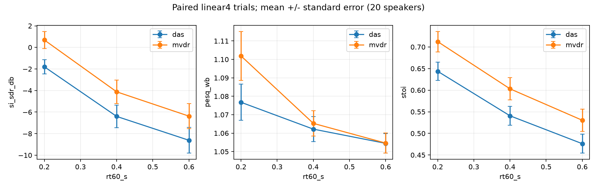
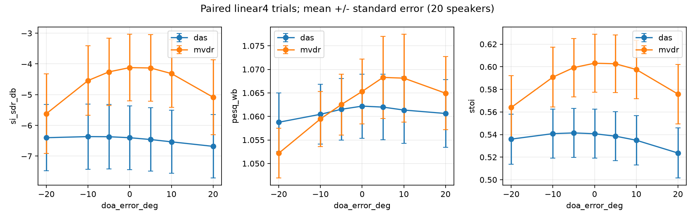

# 配对消融：阵列、混响与导向误差

20 位测试说话人，每人一条最长 4 秒片段；60 次联合阵列房间仿真、1320 次前端评分。
本实验参考为共同虚拟中心的直达目标，区别于主测试的物理参考麦克风；数值不能与主测试直接比较。
每个条件共享语音、点噪声片段、源位置、房间和联合扩散声场。固定最大孔径 0.12 m，
SNR=5 dB/SIR=0 dB 在中心校准；改变 RT60 时重新校准接收比值。
不同阵列的导向矢量均相对于共同中心，不通过不同参考通道延迟制造几何差异。

## 麦克风数量与几何（RT60=0.4 s，导向误差=0）

| 阵列 | 方法 | N | SI-SDR (dB) | PESQ-WB | STOI |
| --- | --- | ---: | ---: | ---: | ---: |
| linear2 | das | 20 | -6.531 | 1.053 | 0.536 |
| linear2 | mvdr | 20 | -5.550 | 1.056 | 0.566 |
| linear4 | das | 20 | -6.401 | 1.062 | 0.541 |
| linear4 | mvdr | 20 | -4.120 | 1.065 | 0.603 |
| linear6 | das | 20 | -6.434 | 1.064 | 0.537 |
| linear6 | mvdr | 20 | -3.851 | 1.072 | 0.609 |
| circular4 | das | 20 | -5.699 | 1.060 | 0.566 |
| circular4 | mvdr | 20 | -2.064 | 1.077 | 0.656 |
| circular6 | das | 20 | -5.484 | 1.067 | 0.577 |
| circular6 | mvdr | 20 | -1.202 | 1.084 | 0.688 |

固定孔径下，线阵 MVDR 从 2 到 6 麦的 SI-SDR 从 −5.550 提升至 −3.851 dB，
而 DAS 的数量增益较小；说明增加通道与扩大孔径不能混为一谈。
同为 6 麦时圆阵 MVDR 为 −1.202 dB、线阵为 −3.851 dB；
这是当前 20 个位置/角度的结果，不足以断言圆阵对所有方向更优。
两麦圆阵退化为一个直线麦克风对，因此只报告一次 linear2，不制造重复几何条件。

## 线阵 4 麦的 RT60 与导向误差

| RT60 (s) | 导向误差 (°) | 方法 | SI-SDR (dB) | STOI |
| ---: | ---: | --- | ---: | ---: |
| 0.2 | 0 | das | -1.799 | 0.644 |
| 0.4 | -20 | das | -6.401 | 0.536 |
| 0.4 | -10 | das | -6.365 | 0.541 |
| 0.4 | -5 | das | -6.369 | 0.541 |
| 0.4 | 0 | das | -6.401 | 0.541 |
| 0.4 | 5 | das | -6.460 | 0.539 |
| 0.4 | 10 | das | -6.535 | 0.535 |
| 0.4 | 20 | das | -6.682 | 0.524 |
| 0.6 | 0 | das | -8.615 | 0.476 |
| 0.2 | 0 | mvdr | 0.685 | 0.712 |
| 0.4 | -20 | mvdr | -5.619 | 0.564 |
| 0.4 | -10 | mvdr | -4.541 | 0.591 |
| 0.4 | -5 | mvdr | -4.259 | 0.599 |
| 0.4 | 0 | mvdr | -4.120 | 0.603 |
| 0.4 | 5 | mvdr | -4.132 | 0.603 |
| 0.4 | 10 | mvdr | -4.314 | 0.598 |
| 0.4 | 20 | mvdr | -5.083 | 0.576 |
| 0.6 | 0 | mvdr | -6.376 | 0.530 |

RT60 的配对变化（0.2→0.6 s、导向误差为零）：

- das: SI-SDR -1.799→-8.615 dB，STOI 0.644→0.476。
- mvdr: SI-SDR 0.685→-6.376 dB，STOI 0.712→0.530。

方向误差敏感度用 ±20° 对称均值与 0° 配对比较，避免只选有利一侧：

- das: 0° 为 -6.401 dB，±20° 均值为 -6.541 dB，变化 -0.140 dB。
- mvdr: 0° 为 -4.120 dB，±20° 均值为 -5.351 dB，变化 -1.231 dB。

变化描述只适用于本协议；有限校准噪声、混响失配、目标/干扰角度共同影响结果。
误差条为跨 20 位说话人的均值标准误，不是独立麦克风样本数或总体保证。
未把主测试的非配对 RT60 分组曲线当作因果证据。

