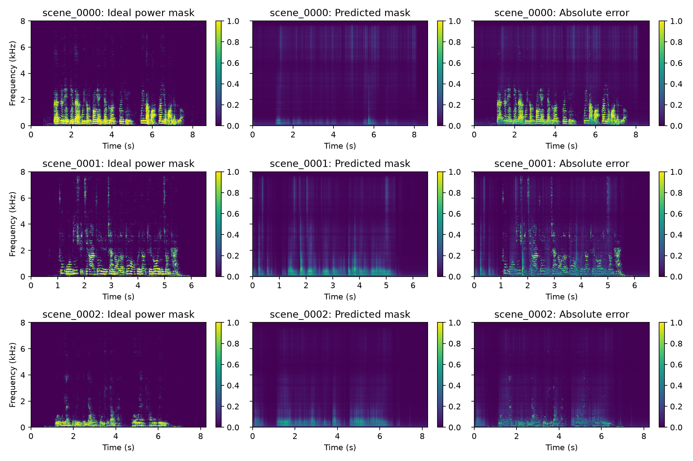

# 掩码训练与前端对照

相同的 200 条原始 AISHELL 测试语音；所有指标排除 0.6 s 校准前缀。
SI-SDR/PESQ/STOI 使用同一参考麦克风直达目标信号。CER 在第六阶段汇总。

| 前端 | N | SI-SDR (dB) | PESQ-WB | STOI |
| --- | ---: | ---: | ---: | ---: |
| ref_mic | 200 | -8.3272 | 1.0638 | 0.4860 |
| das | 200 | -6.0904 | 1.0790 | 0.5242 |
| oracle_mvdr | 200 | -2.5008 | 1.1024 | 0.6163 |
| irm_mvdr | 200 | -1.9778 | 1.1771 | 0.6018 |
| neural_mvdr | 200 | -6.1756 | 1.0740 | 0.5123 |
| project1_singlechannel | 200 | -4.8706 | 1.1641 | 0.4997 |

## 实际结论

1. IRM-MVDR 的 SI-SDR 为 −1.9778 dB；神经 MVDR 为 −6.1756 dB，差距约 4.20 dB，表明理想分量监督提供了明显但尚未达到的参考水平。IRM 含测试真值，不能部署；也不保证逐指标绝对上界。
2. 神经 MVDR 在当前训练规模下没有超过 DAS（−6.0904 dB，STOI 0.5242）。验证损失下降并不等于空间滤波增益提升，不能把训练成功写成性能胜出。
3. 相同网络的单通道补充模块 SI-SDR 为 −4.8706 dB、PESQ 为 1.1641，但 STOI 仅 0.4997。掩码误差、协方差偏差、混响参考差异是待验证假设；CER 需独立实测。

## 证据

网络 83,137 参数，两层单向 GRU，参考通道 log-power 输入，软 IRM BCE 训练。
320 条原始 train 语音、80 条原始 dev 语音，各两次仿真；20 个 epoch，最佳 dev epoch=19。
单 batch 576 步 MSE 从 0.157479 降至 0.009991；该预检模型未用于正式训练。
train/dev/test 说话人与源噪声分离；归一化仅拟合 train。完整检查点与每轮日志保存在本机 checkpoints/mask_gru/。
项目一模块是本轮在 /home/kingcrab/speech-front-end/denoising 补建的对照，复用同一模型权重；不是独立预训练系统，不能声称项目一完整 AEC/VAD 已完成。

